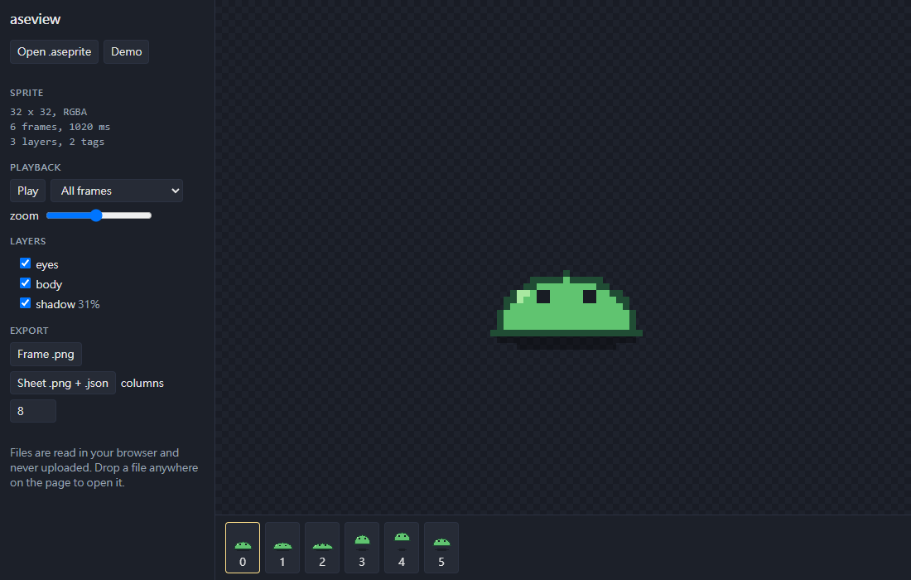

# aseview

[English](README.en.md)

在瀏覽器開 Aseprite 檔（.ase / .aseprite），看圖層、影格、標籤動畫，匯出單張 PNG 或 sprite sheet。檔案只在瀏覽器裡讀，不會上傳。

線上使用：https://vtxe02023274.github.io/aseview/



## 功能

- RGBA、灰階、索引色三種模式，索引色的透明色只套用在非背景圖層
- 圖層開關、群組、圖層與 cel 透明度、cel 的 z-index 排序
- 圖塊地圖圖層（tilemap），含水平、垂直、對角翻轉
- 照每格的時間播放，可以選標籤，支援 forward／reverse／ping-pong
- 2.5D 切片堆疊（sprite stacking）預覽：圖層或影格當成由下往上的切片，可以拖曳旋轉、調切片高度；按「Stack demo」看範例
- 匯出目前影格 PNG、選定標籤的 GIF 動畫，或整張 sprite sheet PNG＋JSON

GIF 用 sprite 裡的原色（最多 255 色），不抖色；超過 255 色會提示改用 sprite sheet。編碼器是自己寫的，用 Chrome 內建的 GIF 解碼器逐像素比對過。

匯出的 JSON 跟 Aseprite 的「Array」格式一樣，影格名稱是編號，Phaser 可以直接用：

```js
this.load.aseprite('slime', 'demo.png', 'demo.json');
this.anims.createFromAseprite('slime'); // 會建出 idle、jump 兩個動畫
```

PixiJS 等讀 TexturePacker／Aseprite JSON 的引擎也能讀。

## 指令列

不用裝 Aseprite，用 Node.js 20 以上就能批次匯出，適合放進建置流程：

```sh
npx github:vtxe02023274/aseview hero.aseprite -o build/sprites --columns 8 --gif
# hero.png、hero.json（Aseprite Array 格式）、每個標籤一個 GIF
```

| 參數              | 作用                                                     |
| ----------------- | -------------------------------------------------------- |
| `-o, --out <dir>` | 輸出資料夾，預設跟原檔同一層                             |
| `--columns <n>`   | sheet 每排幾格，預設全部排一排                           |
| `--scale <n>`     | 每個像素放大 n 倍（像素圖用，最近鄰），JSON 座標一起放大 |
| `--split-layers`  | 另外每個圖層各輸出一張 sheet＋JSON（疊回去等於完整圖）   |
| `--gif`           | 每個標籤各輸出一個 GIF                                   |
| `--hide <layer>`  | 依名稱略過某個圖層，可以重複使用                         |

## 支援範圍

用 Aseprite 原始碼裡的測試 sprite（索引色、灰階、tilemap、群組、z-order、標籤、切片、屬性）和 LibreSprite 的 splash.ase（54 圖層）測過，都能正確讀取與合成。

混合模式支援 normal、multiply、screen、darken、lighten、difference、addition、subtract，其他模式先當 normal 畫，圖層清單會標出來。參考圖層（reference layer）跟 Aseprite 匯出時一樣不畫。外部 tileset、外部調色盤不會讀。

## 示範檔

`public/demo.aseprite`（史萊姆，3 圖層、6 影格、2 個標籤）和 `public/stack-demo.aseprite`（樹，14 層切片）都是 `tools/make-demo.mjs` 用程式畫的，沒有用到第三方素材。

## 開發

```sh
npm install
npm run build   # 輸出到 site/
npm test
npm run lint
```

`src/ase.ts` 是讀檔，`src/composite.ts` 合成影格，`src/sheet.ts` 排 sprite sheet，都不依賴瀏覽器，可以在 Node 裡用（解壓縮傳 `zlib.inflateSync` 進去）。

## 授權

MIT。Aseprite 是 Igara Studio 的軟體，本專案跟它沒有關係，只依照公開的檔案格式規格讀檔。
